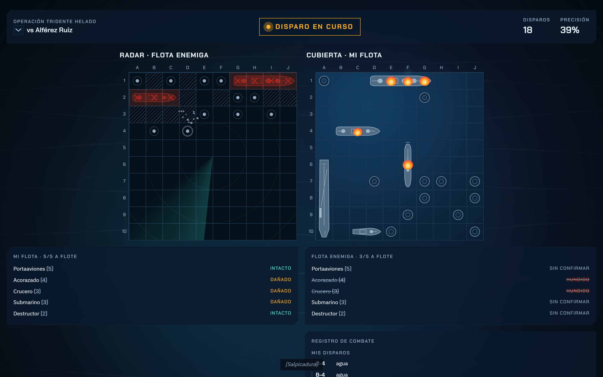

# Battleships: Naval Warfare

[](https://github.com/adrogodev/battleships-naval-warfare/actions/workflows/ci.yml)

A browser naval battle with a combat-information-center look: a living ocean, a sweeping radar, explosions and audio generated in real time. Play against three AI commanders with measurable strategies, or against another person online through a server that is the only authority over the game.

> The game UI is in Spanish. All texts live in `apps/client/src/i18n/`, ready for other languages.



## Quick start

Requirements: Node 24 or later and pnpm 10.

```bash
pnpm install
pnpm dev                                   # client on http://localhost:5173
```

To play online, start the server in another terminal and open the game in two tabs:

```bash
pnpm --filter @battleships/server start    # server on port 3001
```

1. Press **Pulsa para comenzar** (enables audio) and choose **Multijugador**.
2. Create a private room and share the code or the invitation link.
3. In the other tab, open the link, type your alias and press **Unirse**.

### With Docker

```bash
docker compose up --build                  # client on http://localhost:8080, server on http://localhost:3001
```

`Dockerfile` builds the server (it answers `GET /health`) and `apps/client/Dockerfile` builds the client and serves it with nginx. CI builds both images on every push.

## What's inside

| Area | Details |
|---|---|
| Against the AI | Three commanders: Easy fires at random, Normal sweeps in a checkerboard and finishes hits, Hard uses a probability map. They average 95.5, 52.6 and 38.5 shots to win over 1,000 simulated games ([metrics](docs/AI_METRICS.md)). |
| Multiplayer | Server-authoritative Socket.IO server: rooms with a 6-character code, optional turn timer, quick reactions, reconnection with the game frozen, victory claim and rematch. |
| Progression | Ranks from Grumete to Almirante de Flota, statistics with a heat map and 10 challenges with badges. Everything is cosmetic or statistical: it never changes game balance. |
| Tutorial | An interactive "how to play" of about 60 seconds on a practice board. |
| Accessibility | Arrow-key board navigation, fire with Enter or Space, visible focus, `aria-live` announcements, captions for every sound, reduced motion, high contrast, color-blind mode and text scalable up to 200 %. |
| Presentation | Canvas 2D ocean that pauses when the tab is hidden and lowers quality when frames drop, particles from a pool of 150 and 100 % procedural audio with Web Audio. |
| Persistence | `localStorage` with a versioned schema and migrations; it can be cleared from Settings. |

## Commands

| Command | What it does |
|---|---|
| `pnpm dev` | Client in development mode (Vite) |
| `pnpm --filter @battleships/server start` | Multiplayer server |
| `pnpm build` | Production build |
| `pnpm test` | Unit and integration tests (Vitest) |
| `pnpm test:e2e` | Playwright E2E in Chromium and WebKit; starts the server and a production build |
| `pnpm typecheck` | Strict TypeScript in every package |
| `pnpm lint` / `pnpm format` | Biome: check or fix lint and formatting |
| `pnpm simulate` | 1,000 games per difficulty; rewrites `docs/AI_METRICS.md` |
| `pnpm screenshots` | Regenerates the image in this README (needs `vite preview` on port 4173) |

## Configuration

Server (`apps/server/src/config.ts`), all optional:

| Variable | Default | Use |
|---|---|---|
| `PORT` | `3001` | HTTP and WebSocket port |
| `RECONNECT_WINDOW_SEC` | `60` | Seconds the game waits for a disconnected player |
| `ROOM_IDLE_MIN` | `15` | Minutes until an idle room is deleted |
| `CORS_ORIGINS` | `localhost` and `127.0.0.1` on ports 5173 and 4173 | Comma-separated list of allowed origins |

Client: `VITE_SERVER_URL` points to the server; when unset it uses the page host on port 3001.

## Architecture

```text
packages/shared   Pure domain: rules, state machine, AI and protocol (Zod)
apps/client       React 19 + Vite: screens, boards, audio, effects and progression
apps/server       Node + Socket.IO: rooms, validation and reconnection
e2e/              Playwright: full games in one and two browsers
```

- **One domain.** `reduce(state, action)` is pure and is shared by the client (against the AI), the server and the simulation.
- **The server decides.** It validates schema, room, phase, turn and fleet; each player only receives its own view (`viewFor`), never the rival fleet.
- **The AI plays fair.** It only sees the rival's public board (`publicBoardView`).
- **Presentation separated from state.** The game resolves instantly; `ShotQueue` decides when each result is shown, played and announced.

The protocol is described in [docs/PROTOCOL.md](docs/PROTOCOL.md) and the original plan in [docs/PLAN.md](docs/PLAN.md).

## Tests

- **Vitest:** 403 tests covering the domain, the AI, the protocol, the server with real Socket.IO clients and the client screens.
- **Playwright (Chromium and WebKit):** a full game against the AI; two browsers playing online with a rematch; reload in the middle of a battle; keyboard only with visible focus; mobile view; text at 200 %; a shot round trip under 150 ms.
- **CI (GitHub Actions):** lint, typecheck, Vitest, build, Playwright on Chromium and both Docker images on every push to `main`.

## Status

Phases 1 to 5 are done; public deployment is phase 6. The detailed status, measured performance budgets and known deviations are in [PROJECT_STATUS.md](PROJECT_STATUS.md).

## Credits

Audio generated in real time, with no recorded samples. Fonts Chakra Petch and IBM Plex Sans (SIL Open Font License 1.1). Details in [CREDITS.md](CREDITS.md).
